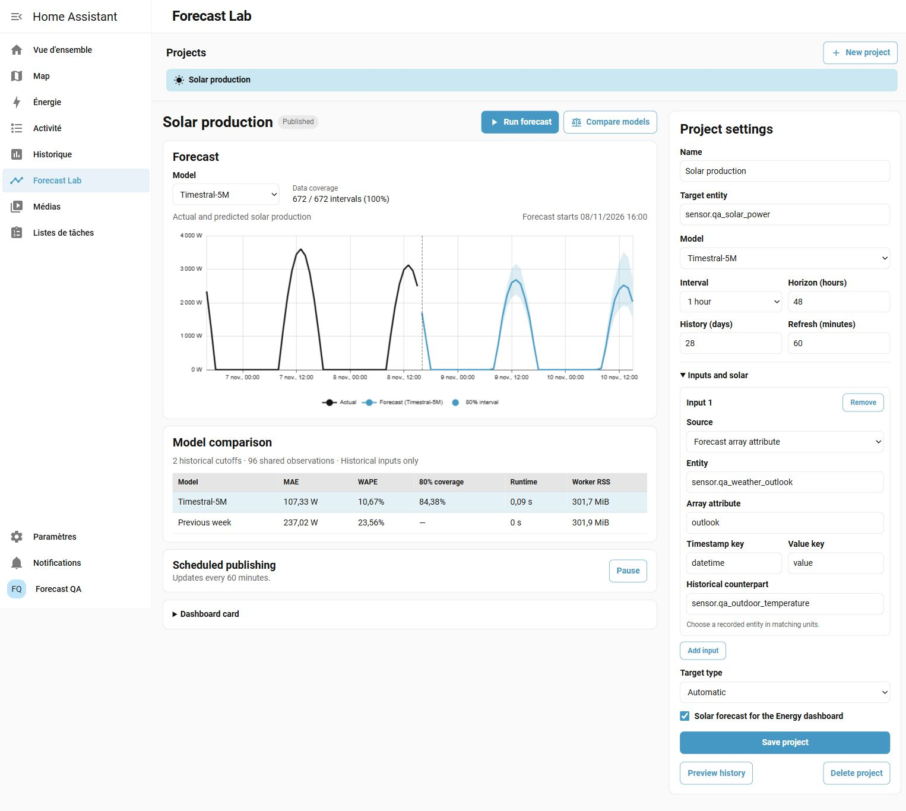

# Local Forecast for Home Assistant

Forecast recorded numeric entities on your own hardware. **Forecast Lab** lets you inspect recorded data, add explanatory inputs, compare models with seasonal baselines, and publish forecasts for dashboards and automations.



## Setup

1. Start the [Local Forecast engine](https://github.com/Elijaht-dev/local-forecast-engine) as an HA app or in Docker.
2. On Home Assistant 2026.11 or newer, install the integration from its custom repository in **Settings → Marketplace** and restart when prompted. For a local build, extract `local_forecast.zip` into `config/custom_components/local_forecast/`.
3. In **Settings → Devices & services**, accept the discovered engine or add **Local Forecast** and enter the engine URL and pairing token.
4. Open **Forecast Lab**. Pick a numeric target, preview its history and save the project. Install Timestral-5M from the model selector or choose a baseline to try the workflow immediately.
5. Run a forecast or compare models, then use **Publish forecast** to enable updates. Install the [Local Forecast Card](https://github.com/Elijaht-dev/local-forecast-card) to plot the published series.

## Data and models

The default forecast is hourly for 48 hours, refreshed every hour, from up to 28 days of history. Preview the target's history to enable 15-minute forecasts when Recorder has at least 32 usable 15-minute observations in the selected window. Eligible sensors can use hourly recorder statistics for older periods. Historical gaps stay missing. A cumulative meter forecasts the energy, water, or other increment per interval.

Use a recorded numeric entity or binary state as an input. For inputs with future values, choose HA hourly weather, an existing Forecast.Solar configuration, or a numeric timestamp/value array in an entity attribute. Choose a historical counterpart for Forecast.Solar or attribute arrays. For weather, the matching recorded attribute is used when available. Use the preview to see which inputs have usable coverage.

Models run in the paired engine and use only selected input series. The engine archives predictions at issue time and compares them with later observations. Historical tests reuse archived forecasts where available and label historical-only tests. Compare models over the same observed intervals and choose the model to publish in project settings.

## Solar

Choose a recorded PV power sensor or cumulative production meter and enable **Solar forecast for the Energy dashboard**. In **Settings → Dashboards → Energy**, select the Local Forecast project as the forecast for your measured solar production source. Each published solar project has its own config entry. The forecast provides hourly Wh, remaining energy today, energy tomorrow, and the upcoming peak. A daily sensor is unavailable when coverage for the requested day is incomplete.

## Actions

```yaml
action: local_forecast.get_forecast
data:
  entity_id: sensor.solar_production_next_interval
response_variable: forecast
```

The response contains the forecast status, issue time, cutoff, interval, unit, and points. `local_forecast.refresh` accepts the same sensor and queues a new run for a published project. Forecast arrays are read through the action and card API.

## Build and test

```sh
npm ci
npm run build
python scripts/package.py
docker run --rm --entrypoint python -e PYTHONPATH=/repo -v "$PWD:/repo:ro" \
  ghcr.io/home-assistant/home-assistant:2026.11.0 -m unittest discover -v -s /repo/tests
```

`tests/smoke_ha.mjs` checks a disposable HA instance configured with `tests/fixtures/configuration.yaml`. Expose HA on loopback port 18123 and run the engine on the same Docker network. Set `LF_TOKEN` and, if needed, `LF_TEST_ENGINE_URL`. Install Timestral-5M on the test engine first. With Node 24, run `node tests/smoke_ha.mjs`. The test imports synthetic recorder data, checks interval eligibility, runs and refreshes the real model, verifies its sensors and actions, selects two solar projects through the Energy API, and compares forecasts against held-out history.

The integration is MIT licensed. The engine links to each model's upstream license.
